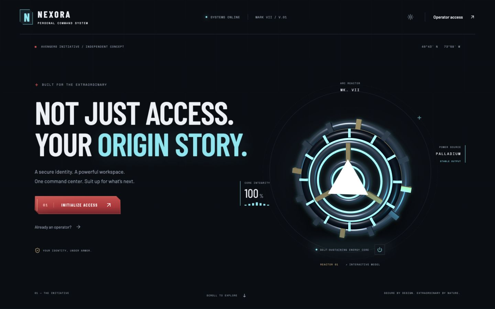
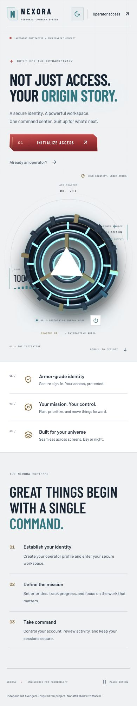
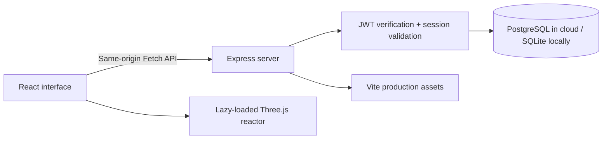

<div align="center">


# NEXORA

### Your identity. Your missions. Your command center.

An Avengers-inspired full-stack workspace with a live 3D arc reactor,<br/>secure authentication, and a personal mission console.

[Live app](https://nexora-rachit.onrender.com) · [Explore the source](https://github.com/rachit1807/nexora) · [Features](#the-experience) · [Run locally](#run-locally) · [API](#api-reference)


</div>

---



## The experience

Nexora turns an authentication assignment into a complete personal command system. Its interface pairs crimson metal controls and cyan reactor lighting with condensed typography, a technical display, and an original procedural WebGL model.

| Area | What you can do |
| --- | --- |
| Identity | Register, sign in, restore a session after refresh, and sign out securely |
| Mission control | Create missions, choose priority, advance queued → active → complete, and delete with confirmation |
| Organization | Search mission titles, filter by status, see progress totals, and export a JSON archive |
| Operator profile | Update your display name, change your password, and sign out other devices |
| Security log | Review recent account and mission activity and view the active session count |
| Appearance | Switch between persistent light/dark themes and pause decorative motion |
| Reactor | Interact with a layered Three.js reactor, illuminated rings, floating motion, and overdrive mode |
| Mobile | Use a stacked layout, touch-friendly controls, responsive dialogs, and a compact mission list |

The reactor is geometry rendered in the browser, rather than a flat background image. The renderer caps pixel density, skips rendering while the tab is hidden or the model is off-screen, respects reduced-motion preferences, and supplies a CSS fallback when WebGL is unavailable.

<details>
<summary><strong>Mobile light-theme preview</strong></summary>
<br/>

</details>

## Architecture



A single Node.js service serves the API and compiled React app. This keeps authentication on the same origin, avoids cross-domain cookie configuration, and makes deployment straightforward. PostgreSQL provides durable cloud storage; local development uses SQLite without an external database account.

### Authentication flow

1. Registration validates input and stores a bcrypt password hash. Login verifies the hash.
2. The server creates a revocable database session and signs a JWT with a seven-day expiry, issuer, and audience.
3. The JWT is stored in an `HttpOnly`, `SameSite=Strict` cookie (`Secure` in production). The returned access token is held in memory and sent in the `Authorization: Bearer` header for API calls.
4. On refresh, `/api/auth/session` retrieves the session from the cookie and restores the in-memory token.
5. Every protected endpoint checks both the JWT and the database session. Mission queries are scoped to the authenticated user.
6. Signing out revokes the session. Changing a password revokes all sessions and issues a replacement for the current device.

Tokens are not saved to local storage. Only appearance preferences are stored there. Responses containing account data are not cached. The server includes request limits, input validation, parameterized database statements, security headers, and a same-origin check for writes.

## Run locally

**Requirements:** Node.js 24 and npm. Open the project folder in Visual Studio Code.

```bash
git clone https://github.com/rachit1807/nexora.git
cd nexora
npm ci
npm run dev
```

Open the Vite URL printed in the terminal, normally **http://localhost:5173**. The API runs on **http://localhost:3001**, with Vite proxying `/api` calls. Restart the API process after editing server files.

For a local preview of the production build:

```bash
npm run build
npm start
```

Open **http://localhost:3001**. Create your own account; there are no shared default credentials or seeded cloud accounts.

### Environment variables

Local development works without environment configuration: SQLite is created in the ignored `data/` directory and a temporary signing key is generated. Restarting without a persistent signing key invalidates existing tokens.

To use configuration locally, copy `.env.example` to `.env`, set the values, then launch Node with its environment-file option:

```bash
node --env-file=.env server/index.js
```

| Variable | Purpose |
| --- | --- |
| `PORT` | API port; defaults to `3001` |
| `JWT_SECRET` | Private random signing key; required in production; use at least 32 random characters |
| `DATABASE_URL` | PostgreSQL URL; omit to use local SQLite |
| `NODE_ENV` | Set to `production` on the live host to enable secure cookies and required signing key |
| `DATA_DIR` | Optional local SQLite folder; defaults to `data` |
| `DB_SSL` | Optional `false` only for local PostgreSQL without TLS; cloud connections use certificate verification |

Keep secrets out of commits, screenshots, and frontend variables. Configure them through your hosting provider's environment settings.

## Commands and verification

| Command | Result |
| --- | --- |
| `npm run dev` | Starts the API and Vite development server together |
| `npm run build` | Compiles and splits production assets |
| `npm start` | Serves the API and production frontend |
| `npm test` | Runs isolated backend integration tests with a temporary SQLite database |

The automated suite covers registration validation, duplicate emails, invalid login, JWT rejection, cross-origin write rejection, cookie properties, session restoration, private mission ownership, mission status validation, profile updates, session revocation, password changes, deletion, and logout. GitHub Actions runs the tests and build on pushes to `main` and pull requests.

## API reference

All routes return JSON. Protected routes accept the session cookie or an `Authorization: Bearer <token>` header. Mutating browser requests must come from the same origin.

| Method | Endpoint | Purpose |
| --- | --- | --- |
| `GET` | `/api/health` | Application and database readiness |
| `POST` | `/api/auth/register` | Register with `name`, `email`, and `password` |
| `POST` | `/api/auth/login` | Authenticate with `email` and `password` |
| `GET` | `/api/auth/session` | Restore authenticated identity and token |
| `POST` | `/api/auth/logout` | Revoke current session and clear cookie |
| `GET` | `/api/dashboard` | Retrieve private missions, activity, and session count |
| `POST` | `/api/missions` | Create with `title` and `priority` (`normal`, `high`, `critical`) |
| `PATCH` | `/api/missions/:id` | Set `status` (`queued`, `active`, `complete`) |
| `DELETE` | `/api/missions/:id` | Delete an owned mission |
| `PATCH` | `/api/account` | Update display `name` |
| `PATCH` | `/api/account/password` | Change with `currentPassword` and new `password` |
| `POST` | `/api/account/revoke` | Revoke all other sessions |

## Project structure

```text
nexora/
├── src/
│   ├── main.jsx          # React views, forms, and same-origin API client
│   ├── Reactor.jsx       # Procedural WebGL reactor and resource cleanup
│   └── styles.css        # Responsive themes, controls, and motion
├── server/
│   ├── app.js            # Authentication, authorization, and REST endpoints
│   ├── db.js             # PostgreSQL / SQLite adapter and schema
│   └── index.js          # Server entry point
├── tests/auth.test.js    # Isolated integration suite
├── public/favicon.svg   # Original Nexora emblem
├── docs/screenshots/    # Verified interface previews
└── .github/workflows/   # Automated build and test checks
```

## Deployment

The app is designed for a Node.js web service with a separate durable PostgreSQL database.

- **Build:** `npm ci && npm run build`
- **Start:** `npm start`
- **Node version:** `24`
- **Environment:** `NODE_ENV=production`, a private `JWT_SECRET`, and `DATABASE_URL`
- **Readiness endpoint:** `/api/health`

On Render, use the Nexora workspace and connect the repository's `main` branch. A free web service can sleep when idle, so the first visit may take longer. Use PostgreSQL for hosted data: a free service's local filesystem does not persist across restarts or redeployments. The app initializes its tables on startup.

This is a portfolio and learning project. Email verification, email-based password recovery, MFA, and enterprise identity federation are outside its current scope.

## Design and credits

Built by [Rachit Tripathi](https://github.com/rachit1807). Reactor geometry and the Nexora emblem are original project assets. Interface icons come from [Lucide](https://lucide.dev/), technology icons from [Skill Icons](https://skillicons.dev/), and typography from [Google Fonts](https://fonts.google.com/).

Nexora is an independent Avengers-inspired fan project. It is not affiliated with or endorsed by Marvel, Disney, or Microsoft. Referenced characters and fictional concepts belong to their respective owners.
